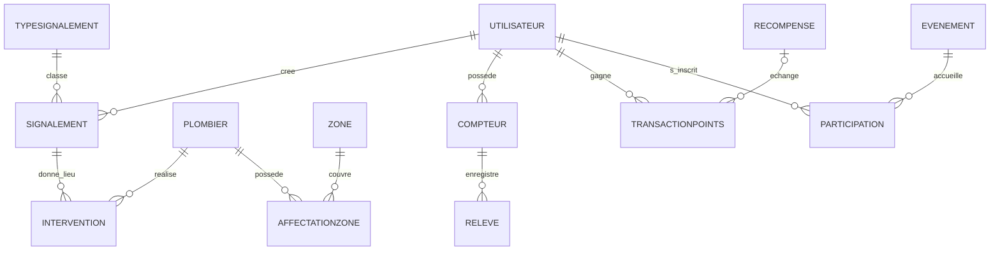
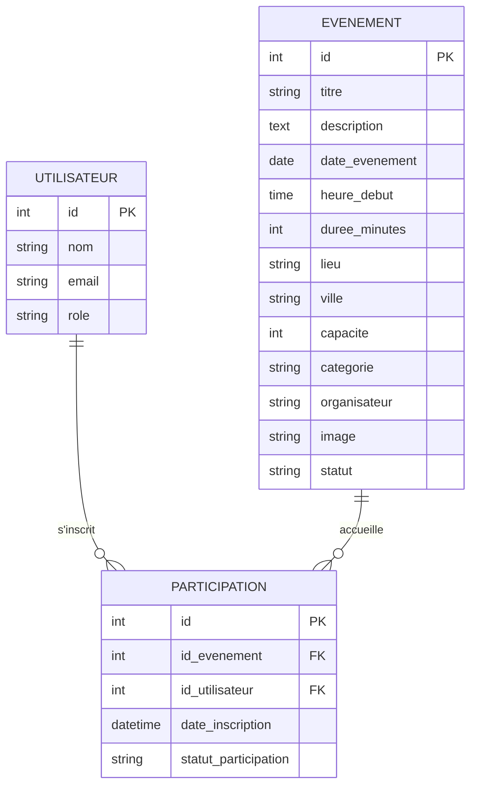

# 💧 AquaFlow — Modules & Pages Specification

> **Master file for building the AquaFlow HTML templates.**
> It explains every *gestion* (module), its functionality, its entities and the pages to build, with **extra depth on Module 5 — Gestion des événements** (graded).
> Source documents: `Modules_aquaflow.docx` (entities, JOINs, CRUD) and `modules_visualization.docx` (interfaces, sample data, inspiration screenshots).

---

## 0. How to use this file

### 0.1 The three files work together

| File | Answers the question | Wins when there is a conflict on… |
|---|---|---|
| `NOVA_DESIGN_SYSTEM.md` | **How does it look?** colors, fonts, layout, components, status colors | anything visual |
| `TODO_Semaine_Prochaine.md` | **How is it organised?** MVC, `includes/` / `partials/`, `layout.php`, controllers, GitHub rules | folder structure, naming, workflow |
| `AQUAFLOW_MODULES_SPEC.md` (this file) | **What do we build?** modules, entities, pages, content, sample data | page content and functionality |

### 0.2 Scope rules (important)

- **Templates only.** We build the HTML pages (views) — **no database, no backend logic, no JavaScript logic.**
- PHP is used **only** for `require_once` of the shared partials and for the `$title` / `$currentPage` variables (as required by the workshop). No loops, no queries.
- All data on screen is **static sample data** (§4.8 for events). It must be realistic, consistent between pages, and in French.
- Interactions (modals, dropdowns, tabs) are shown through markup/CSS (Bootstrap data attributes are fine). Where a state matters for grading (full event, cancelled event, empty list), it must be **visible in a page or a clearly labelled variant**.
- Every page respects the design system: same sidebar, same cards, same buttons, same status pills, French UI copy.

### 0.3 Naming note (decision to confirm)

The documents call the product **AquaFlow**, while the design-system screenshots show a **NOVA** logo. Default used here: keep the NOVA visual identity (colors, fonts, layout) and write **“AquaFlow”** in page titles (`<title>… | AquaFlow</title>`), README and footer text. Confirm with the team whether the wordmark in the sidebar also changes.

---

## 1. Product overview

AquaFlow is a smart water-management platform: citizens report leaks and follow repairs, administrators dispatch plumbers, consumption is monitored through meter readings, awareness events are organised, and citizens earn rewards for saving water.

### 1.1 Roles

| Role | Space | What they do |
|---|---|---|
| **Citoyen** | Front Office (`ESPACE CITOYEN`) | Report leaks, follow reports, see consumption, **browse/register to events**, earn rewards |
| **Administrateur** | Back Office (`PILOTAGE`) | Manage reports, interventions, plumbers, consumption, **events & participants**, rewards |
| **Plombier** | Technician space (`MON ESPACE`) | Sees assigned interventions and updates their status (account belongs to the shared Users module) |
| **SONEDDE / partenaires** | no account in the templates | Appear as the **organiser** of an event (a label chosen by the administrator) |

### 1.2 The six modules at a glance

| # | Module | Purpose (one line) | Main entities | Key JOIN |
|---|---|---|---|---|
| 1 | Gestion des signalements | Citizens report leaks; admins manage reports | Signalement, TypeSignalement, Utilisateur | Utilisateur → Signalement ← TypeSignalement |
| 2 | Gestion des interventions | Manage repairs from report to resolution | Signalement, Intervention, Plombier | Signalement → Intervention ← Plombier |
| 3 | Gestion des plombiers | Manage plumbers, availability and zones | Plombier, Zone, AffectationZone | Plombier → AffectationZone → Zone |
| 4 | Gestion des compteurs et relevés (consommation) | Monitor water consumption | Compteur, Relevé, Utilisateur | Utilisateur → Compteur → Relevé |
| 5 | **Gestion des événements** | Organise awareness events; citizens participate | **Événement, Participation, Utilisateur** | **Événement → Participation → Utilisateur** |
| 6 | Gestion des récompenses | Points & rewards for saving water | TransactionPoints, Récompense, Utilisateur, Compteur, Relevé | Utilisateur → TransactionPoints → Récompense |

> **Shared entity:** `Utilisateur` (citoyen / administrateur / plombier) is used by almost every module. Its pages (Sign in, Sign up, profile) come from the workshop template (`signin`, `signup`).

### 1.3 Global entity map



*(A plumber is also a user account; the diagram keeps `PLOMBIER` separate to follow the module document.)*

---

## 2. Global conventions for all pages

### 2.1 Navigation (extends the design-system nav sets)

The design system fixes the existing labels; this project **adds one item, `Événements`**, to the citizen and admin sidebars. Keep every other label unchanged.

| Space | Sidebar order |
|---|---|
| Citoyen | Accueil · Signaler une fuite · Mes signalements · Consommation · **Événements** · Mes récompenses |
| Administrateur | Tableau de bord · Signalements · Interventions · Citoyens · Plombiers · Consommation · **Événements** · Récompenses · *(SYSTÈME)* Paramètres |
| Plombier | Accueil · Mes interventions · Mon planning · Historique · Mon profil |

Sidebar icon for `Événements`: Lucide `calendar-days`. Active-state key (`$currentPage`): `evenements` (citizen) / `admin-evenements` (admin).

### 2.2 Status vocabulary (same status → same color everywhere)

| Module | Statuses | Pill style (design-system tokens) |
|---|---|---|
| Signalements | Nouveau · En cours · Résolu | amber · blue · green |
| Interventions | En attente · En cours · Terminée | amber · blue · green |
| Plombiers (availability) | Disponible · Occupé | `● Disponible` green dot · `● Occupé` amber dot |
| Événements | À venir · En cours · Terminé · Annulé · *Complet* | see §4.7 |
| Récompenses | Disponible · Stock épuisé | green · neutral grey |

### 2.3 Data & copy conventions

- Language: **French**. Dates `DD/MM/YYYY` (short form `22/03`), time `HH:MM`, numbers `1 284`, `8,4`, percent `80 %`.
- Currency: `80 DT`. Units: `m³`, `pts`.
- Current “today” in sample data: **16/11/2026**.
- No remote images or stock photos: use local files in `assets/images/` or CSS gradient/icon placeholders.
- Fictional people only (first names from the documents: Ahmed, Mariem, Sami, Ali, Youssef, Karim).

---

## 3. Modules 1–4 and 6 — what each does and what to build

> Each module has **Interface A** (list/overview) and **Interface B** (detail/form), taken from `modules_visualization.docx`. The layouts follow the design system (cards, tables, pills, tabs).

### 3.1 Module 1 — Gestion des signalements

- **Objective:** citizens report water leaks and other supply problems; administrators manage the reports.
- **Entities / JOIN:** `Signalement`, `TypeSignalement`, `Utilisateur` — *display all reports with the citizen's name and the type of problem.*
- **CRUD:** Create (citizen reports a leak) · Read (consult reports) · Update (change status/info) · Delete (remove a report).
- **Interface A — Liste des signalements (Administrateur):** table `ID · Citoyen · Type · Localisation · Statut`; buttons *Ajouter un signalement, Modifier, Supprimer, Voir détails, Filtrer par statut*.

| ID | Citoyen | Type | Localisation | Statut |
|---|---|---|---|---|
| #001 | Ahmed | Fuite | Tunis | Nouveau |
| #002 | Mariem | Canalisation cassée | Ariana | En cours |
| #003 | Sami | Fuite | Nabeul | Résolu |

- **Interface B — Signaler une fuite (Citoyen):** form `Type · Adresse · Description · Photo · Date` (e.g. *Fuite d'eau · Rue Habib Bourguiba · Fuite au niveau du trottoir · fuite.jpg · 15/11/2026*); button **Envoyer le signalement**.
- **Inspiration (from the visualization doc):** a dashboard with 3 KPI cards (active leaks / resolved today / critical cases) above a “Leak reports” table with colored type badges and a *Mark resolved* action.

### 3.2 Module 2 — Gestion des interventions et réparations

- **Objective:** manage the repair process from the moment a leak is reported until it is resolved.
- **Entities / JOIN:** `Signalement`, `Intervention`, `Plombier` — *each intervention with its leak, assigned plumber and repair status.*
- **CRUD:** Create (intervention from a report) · Read · Update (status *En attente → En cours → Terminée*) · Delete.
- **Interface A — Liste des interventions:** table `ID · Signalement · Plombier · Date · Statut`; buttons *Créer une intervention, Affecter un plombier, Modifier le statut, Supprimer, Voir détails*.

| ID | Signalement | Plombier | Date | Statut |
|---|---|---|---|---|
| I01 | #001 | Ali | 16/11 | En attente |
| I02 | #002 | Youssef | 15/11 | En cours |
| I03 | #003 | Karim | 14/11 | Terminée |

- **Interface B — Détails d'une intervention:** `Signalement associé #001 · Plombier assigné Ali · Date prévue 16/11/2026 · Description Réparation d'une canalisation · Statut En cours · Coût estimé 80 DT`. The plumber updates the status *En attente → En cours → Terminée*.
- **Inspiration:** a work-orders table with filter chips (Statut, Priorité, Assigné à, Lieu, Date), colored status pills and pagination.

### 3.3 Module 3 — Gestion des plombiers

- **Objective:** manage plumbers and organise their intervention zones (richer than a single `Plombier` entity thanks to `Zone` and `AffectationZone`).
- **Entities / JOIN:** `Plombier → AffectationZone → Zone` — *all plumbers operating in a given zone.*
- **CRUD:** Create (add a plumber / assign a zone) · Read · Update (info or zones) · Delete (plumber or assignment).
- **Interface A — Liste des plombiers:** table `Nom · Téléphone · Zone · Disponibilité`; buttons *Ajouter un plombier, Modifier ses informations, Supprimer, Consulter ses interventions, Gérer ses zones*.

| Nom | Téléphone | Zone | Disponibilité |
|---|---|---|---|
| Ali | 22 123 456 | Tunis | Disponible |
| Youssef | 55 234 567 | Ariana | Occupé |
| Karim | 98 345 678 | Nabeul | Disponible |

- **Interface B — Profil d'un plombier:** `Nom Ali · Spécialité Plomberie générale · Zone Tunis · Disponibilité Disponible · Interventions terminées 24 · Interventions en cours 2`.
- **Note:** mainly for the administrator; the plumber's login account belongs to the shared Users module.
- **Inspiration:** a zone map with a “technician schedule” side table (name, assigned jobs, zone, availability).

### 3.4 Module 4 — Gestion des compteurs et relevés (consommation d'eau)

- **Objective:** monitor water consumption through meters and readings.
- **Entities / JOIN:** `Utilisateur → Compteur → Relevé` — *the readings of each user's water meter.*
- **CRUD:** Create (add a meter / record a reading) · Read · Update (edit a reading) · Delete (remove a reading).
- **Interface A — Tableau de consommation (“Ma consommation”, Novembre 2026):** KPI `Consommation mensuelle 18 m³` and `Compteur actuel 158 m³`, then *Historique des relevés*; buttons *Ajouter un relevé, Modifier un relevé, Consulter l'historique, Filtrer par période*.

| Date | Index compteur | Consommation |
|---|---|---|
| 01/10 | 120 m³ | — |
| 15/10 | 128 m³ | 8 m³ |
| 30/10 | 140 m³ | 12 m³ |
| 15/11 | 158 m³ | 18 m³ |

- **Interface B — Comparaison de consommation:** bar chart (Août 22 m³ · Septembre 15 m³ · Octobre 20 m³ · Novembre 18 m³) showing whether the citizen consumes more or less over time. Use the design-system bar chart (teal bars) — as a static image/SVG, no chart library logic.
- **Inspiration:** monthly bar chart with toggles *En litres / En m³*, *Jours / Mois*, *Mode comparaison*, plus equivalence cards.

### 3.5 Module 6 — Gestion des récompenses

- **Objective:** encourage citizens to save water through a points-and-rewards system.
- **Entities / JOIN:** `Utilisateur`, `Compteur`, `Relevé`, `TransactionPoints`, `Récompense` — `Utilisateur → TransactionPoints → Récompense`; readings can justify how points were earned.
- **CRUD:** Create (reward / points transaction) · Read (rewards and points earned) · Update (reward or its availability) · Delete (reward).
- **Interface A — Espace récompenses (Citoyen):** `Mon solde de points 450 points (+50 points ce mois-ci)`; reward cards *Gourde réutilisable 200 points — Disponible*, *Sac écologique 300 points — Disponible*; *Historique des points*: `Économie d'eau +50`, `Économie d'eau +30`, `Échange de gourde −200`.
- **Interface B — Gestion des récompenses (Administrateur):** table `Récompense · Coût · Stock` — Gourde 200 pts / 15 · Sac écologique 300 pts / 20 · Bon d'achat 500 pts / 10; buttons *Ajouter une récompense, Modifier le coût en points, Modifier le stock, Supprimer une récompense, Consulter les échanges*.
- **Inspiration:** points balance card with progress to next level, rewards catalogue cards with *Redeem*, “recent activity” list with green `+` / red `−` amounts.

---

# 4. ⭐ Module 5 — Gestion des événements (detailed specification)

## 4.1 Objective and concept

Organise **events and awareness campaigns about water conservation**. Administrators, **SONEDDE** or **partner organisations** (municipalities, associations) create events; **citizens discover them and register / unregister**; administrators **manage participants and attendance**.

| Role | Functionalities (from the module documents) |
|---|---|
| **Administrateur** | **Create**, **modify**, **delete / cancel** events · **manage participants** and **attendance** |
| **Citoyen** | **Browse** available events · **register** · **unregister** · see own participations |

## 4.2 Entities and data model

Required by the documents: **Événement**, **Participation**, **Utilisateur**. Event fields required: *title, description, date, location, capacity*. The extra attributes below are **proposed** (needed to match the example interface and the inspiration cards) — confirm with the tutors before freezing the class diagram.



**Value lists (used by selects, filters and pills):**

| Field | Values |
|---|---|
| `statut` (Événement) | À venir · En cours · Terminé · Annulé |
| `statut_participation` | Inscrit · Présent · Absent · Désinscrit |
| `categorie` | Sensibilisation · Atelier · Nettoyage · Conférence |
| `organisateur` | Administration AquaFlow · SONEDDE · Partenaire municipal · Association partenaire |
| `ville` | Tunis · Ariana · Nabeul · *(add as needed)* |

**Business rules to reflect in the UI (messages, disabled buttons, badges):**

1. A citizen can register **once** per event (unique `id_evenement + id_utilisateur`).
2. Registration is possible only for **À venir** events that are **not full** (`participants < capacité`).
3. A citizen can unregister while the event is still **À venir**.
4. The administrator cannot set a capacity **lower than the current number of participants**.
5. Attendance (*Présent / Absent*) can be marked only when the event is **En cours** or **Terminé**.
6. **Cancel** (status *Annulé*, participants kept and informed) is different from **Delete** (event and its participations removed).

## 4.3 CRUD → pages matrix (what the grader should find)

| Operation | Who | Where it is shown | Page |
|---|---|---|---|
| **Create** | Admin | Form “Nouvel événement” + button `+ Nouvel événement` | `admin-evenement-form` |
| **Read** (list) | Admin / Citizen | Table (admin) / cards (citizen) with search, filters, tabs | `admin-evenements`, `evenements` |
| **Read** (detail + participants) | Admin / Citizen | Event detail with participants list | `admin-evenement-details`, `evenement-details` |
| **Update** | Admin | Same form pre-filled “Modifier l'événement” | `admin-evenement-form` (edit) |
| **Update** (attendance / remove participant) | Admin | Participants table actions | `admin-evenement-details` |
| **Delete / Cancel** | Admin | Confirmation modals | `admin-evenements`, `admin-evenement-details` |
| **Register / Unregister** | Citizen | Buttons on cards, detail page, “Mes participations” | `evenements`, `evenement-details`, `mes-participations` |

## 4.4 The JOIN to demonstrate

> *Display each event with the names of the registered citizens, their registration dates and the total number of participants.* — `Événement → Participation → Utilisateur`

Shown on the **admin event details page** as the **“Participants inscrits”** card:

| Citoyen (from Utilisateur) | E-mail (Utilisateur) | Date d'inscription (Participation) | Présence (Participation) |
|---|---|---|---|

with a footer line **“Total : N participants · X places restantes”** and a counter chip **“N / capacité”** in the card header. On the admin **list** page, the first row is shown **expanded** (chevron) with 3 participants and a link “Voir les N participants” (recommended bonus).

## 4.5 Pages inventory

### Back Office (Administrateur)

| Page key | View file (suggested) | Purpose |
|---|---|---|
| `admin-evenements` | `Views/pages/admin/evenements.php` | List of all events + KPIs + filters + delete/cancel modals |
| `admin-evenement-form` | `Views/pages/admin/evenement-form.php` | Create **and** edit (same layout; title and button text change) |
| `admin-evenement-details` | `Views/pages/admin/evenement-details.php` | One event + participants (JOIN) + attendance + actions |

### Front Office (Citoyen)

| Page key | View file (suggested) | Purpose |
|---|---|---|
| `evenements` | `Views/pages/front/evenements.php` | Catalogue of events (cards, filters, tabs) |
| `evenement-details` | `Views/pages/front/evenement-details.php` | One event: info, spots, register/unregister |
| `mes-participations` | `Views/pages/front/mes-participations.php` | Events the citizen registered to, with unregister |

Controllers/Models (names only, per the MVC workshop): `EvenementController`, `ParticipationController`, `Evenement.php`, `Participation.php`, `Utilisateur.php`. Layout, sidebar, header, footer and scripts come from the shared partials — event pages contain **only the page content**.

## 4.6 Page-by-page specification

> Common to all pages: sidebar (with `Événements` active), page header (eyebrow + H1 + subtitle), white cards on `#F4F9FC`, teal primary buttons with dark-navy text, soft shadows, 20 px gaps. Citizen pages also have the topbar with breadcrumb.

### 4.6.1 `admin-evenements` — Liste des événements (Back Office)

**Header:** eyebrow `ÉVÉNEMENTS` · H1 **Gestion des événements** · subtitle *« Organisez les campagnes de sensibilisation et suivez les inscriptions. »* · actions: outline `Exporter` + primary `+ Nouvel événement`.

**KPI row (4 cards):**

| Label | Value | Delta line |
|---|---|---|
| Total événements | 6 | `3 à venir` |
| Événements à venir | 3 | `Prochain : 22/03/2027` |
| Participants inscrits | 157 | `aux événements à venir` |
| Taux de remplissage | 80 % | `1 événement complet` (amber) |

**Card “Événements” (table):**
- Filter tabs: `Tous (6)` · `À venir (3)` · `En cours (1)` · `Terminés (1)` · `Annulés (1)`.
- Toolbar: search field *« Rechercher un événement… »*, select `Ville`, select `Catégorie`, date filter.
- Table columns: **Événement** (36 px icon tile + bold title + organiser in muted text) · **Date & heure** · **Lieu** · **Catégorie** · **Participants** (`85 / 120` + thin progress bar) · **Statut** (pill) · **Actions** (three 36 px icon buttons: 👁 *Voir*, ✏️ *Modifier*, 🗑 *Supprimer* — `aria-label` on each).
- Row-level extra in the `⋯` menu: *Annuler l'événement*, *Exporter les participants*.
- Footer: pagination `1–6 sur 6 événements`.
- Rows = the sample data of §4.8.

**Modals (markup present in the page):**
- **Supprimer l'événement** — icon tile, title *« Supprimer cet événement ? »*, text *« L'événement “Journée de l'eau” et ses 85 inscriptions seront définitivement supprimés. Cette action est irréversible. »*, buttons `Annuler` (outline) + `Supprimer` (outline with `--danger` text).
- **Annuler l'événement** — title *« Annuler cet événement ? »*, textarea *« Motif de l'annulation (visible par les participants) »*, buttons `Retour` + primary `Confirmer l'annulation`.

### 4.6.2 `admin-evenement-form` — Créer / modifier un événement

**Header:** back link `← Retour aux événements` · eyebrow `ÉVÉNEMENTS` · H1 **Nouvel événement** (create) / **Modifier l'événement** (edit) · subtitle *« Renseignez les informations de l'événement. »*

**Layout:** 2 columns — left wide card **“Informations générales”**, right narrow cards **“Image”** and **“Organisation”**.

| Field | Type | Required | Example / help text |
|---|---|---|---|
| Titre | text | ✔ | Journée de l'eau |
| Description | textarea | ✔ | Une journée de sensibilisation à la préservation de l'eau… |
| Catégorie | select | ✔ | Sensibilisation |
| Organisateur | select | ✔ | SONEDDE |
| Date | date | ✔ | 22/03/2027 |
| Heure de début | time | ✔ | 09:00 |
| Durée (heures) | number | | 4 |
| Lieu | text | ✔ | Parc du Belvédère |
| Ville | select | ✔ | Tunis |
| **Capacité** | number | ✔ | 120 — helper: *« Nombre maximum de participants. »* |
| Image | file upload (drop zone) | | `journee-eau.jpg` |

**States to show:** one field with an inline error (*« Ce champ est obligatoire »*); in edit mode the capacity helper reads *« Minimum 85 : nombre d'inscrits actuel »*; edit mode also shows a read-only chip with the current status.
**Buttons:** primary `Enregistrer l'événement` (edit: `Enregistrer les modifications`) · outline `Annuler`.

### 4.6.3 `admin-evenement-details` — Détails + participants (the JOIN page)

**Sample event:** *Atelier détection de fuites* (status **En cours**, today) so that attendance marking is active.

**Header:** back link · eyebrow `ÉVÉNEMENTS` · H1 event title + status pill · subtitle (date · lieu) · actions: outline `Modifier`, outline `Annuler l'événement`, outline-danger `Supprimer`.

**Row 1 — two cards:**
- **Informations** (left): description, date & heure, durée, lieu (ville), catégorie, organisateur, créé le.
- **Remplissage** (right): large number `18 / 25`, progress bar (teal), text *« 7 places restantes »*, small stats `Présents 12 · Absents 2 · À pointer 4`.

**Row 2 — card “Participants inscrits” (JOIN):**
- Header: title + chip `18 / 25 inscrits`; right: search field + outline `Exporter la liste`.
- Table: **Citoyen** (avatar initials + name) · **E-mail** · **Date d'inscription** · **Présence** (segmented control `Présent` / `Absent`, or pill) · **Actions** (`Retirer`).
- 5 rows shown (§4.8.3), pagination `1–5 sur 18`.
- Footer: **“Total : 18 participants · 7 places restantes”**.
- When the event is *À venir*, the Présence control is **disabled** with tooltip *« Disponible le jour de l'événement »*.

### 4.6.4 `evenements` — Catalogue (Front Office)

**Topbar breadcrumb:** `Espace citoyen / **Événements**`.
**Header:** eyebrow `ÉVÉNEMENTS` · H1 **Événements et campagnes** · subtitle *« Découvrez et participez aux actions pour préserver l'eau de notre ville. »* · location pill `Tunis, Tunisie`.
**Filter bar (card):** search *« Rechercher un événement… »* · select `Ville` · select `Catégorie` · date.
**Tabs:** `À venir (3)` · `Mes inscriptions (2)` · `Passés (1)`.

**Event card (grid of 3 columns):**

```
┌───────────────────────────────┐
│ [image / gradient placeholder]│  ← top-right status pill (À venir / Complet)
├───────────────────────────────┤
│ Journée de l'eau              │  title 16px / 700 navy
│ SONEDDE                       │  organiser, teal-700 12px
│ Une journée de sensibilisation│  description, 2 lines max, muted
│ 📅 22/03/2027                 │
│ 🕘 09:00 • 4 h                │
│ 📍 Parc du Belvédère, Tunis   │
│ 👥 85 sur 120 places          │
│ ▓▓▓▓▓▓▓░░░                    │  progress bar (teal)
│ [Sensibilisation]             │  category tag (outline pill)
│ [ Voir les détails ] [S'inscrire] │
└───────────────────────────────┘
```

**Button states on cards (show each at least once):**

| State | Button | Pill |
|---|---|---|
| Not registered, spots left | primary `S'inscrire` | `À venir` (teal) |
| Already registered | outline `Se désinscrire` + small green `✓ Inscrit` | `À venir` |
| Full | disabled `Complet` | `Complet` (orange) |
| Cancelled | disabled `Annulé` | `Annulé` (grey) |

### 4.6.5 `evenement-details` — Détail d'un événement (Front Office)

**Breadcrumb:** `Espace citoyen / Événements / Journée de l'eau`.
**Layout:** left wide card — banner image (placeholder), title, organiser, description, key facts (date, heure • durée, lieu, catégorie); right sticky card **“Inscription”** — `85 sur 120 places`, progress bar, *« 35 places restantes »*, primary full-width `S'inscrire à cet événement`.
**Registered variant (label in the page or a second file):** card shows `✓ Vous êtes inscrit(e)` + outline `Se désinscrire`.
**Below:** card **“Autres événements à venir”** (2 compact event rows).
**Messages (alert style, visible in the template):** success *« Votre inscription est confirmée. »* · info *« Vous avez annulé votre participation. »*

### 4.6.6 `mes-participations` — Mes participations (Front Office)

**Header:** eyebrow `ÉVÉNEMENTS` · H1 **Mes participations** · subtitle *« Retrouvez les événements auxquels vous êtes inscrit(e). »*
**Tabs:** `À venir (2)` · `Passés (1)` · `Annulés (0)`.
**List rows (card):** icon tile · event title + `date · lieu` · **Inscrit le 02/03/2027** · participation pill (`Inscrit` / `Présent`) · action: outline `Se désinscrire` (upcoming) / `Voir` (past).
**Empty state variant:** tile icon + *« Vous n'êtes inscrit(e) à aucun événement. »* + primary `Découvrir les événements`.
**Modal:** *« Se désinscrire de cet événement ? »* with `Retour` / `Confirmer`.

## 4.7 Event status & participation pills

Built only from existing design-system tokens (no new colors).

| Label | Meaning | Background / text |
|---|---|---|
| **À venir** | scheduled | `--teal-100` / `--teal-700` |
| **En cours** | happening today | `--st-progress-bg` / `--st-progress-fg` (blue) |
| **Terminé** | finished | `--st-done-bg` / `--st-done-fg` (green) |
| **Annulé** | cancelled | `--st-neutral-bg` / `--st-neutral-fg` (grey) |
| **Complet** | capacity reached | `--st-todo-bg` / `--st-todo-fg` (orange) |
| Participation **Inscrit** | registered | teal (same as À venir) |
| Participation **Présent** | attended | green |
| Participation **Absent** | no-show | amber (`--st-pending-*`) |
| Participation **Désinscrit** | withdrew | grey |

**Capacity bar:** track `--track`, fill `--teal-500`; at 100 % the fill turns `--st-todo-fg` (orange).
**Destructive actions:** outline button with `--danger` text/border — never a filled red button.

## 4.8 Sample data (use the same data on every page)

### 4.8.1 Events

| ID | Titre | Date & heure | Durée | Lieu / ville | Organisateur | Catégorie | Participants | Statut |
|---|---|---|---|---|---|---|---|---|
| E01 | Journée de l'eau | 22/03/2027 · 09:00 | 4 h | Parc du Belvédère, Tunis | SONEDDE | Sensibilisation | 85 / 120 | À venir |
| E02 | Nettoyage des plages | 25/03/2027 · 08:30 | 3 h | Plage de Nabeul, Nabeul | Association partenaire | Nettoyage | 42 / 60 | À venir |
| E03 | Atelier économie d'eau | 02/04/2027 · 14:00 | 2 h | Salle municipale, Ariana | Administration AquaFlow | Atelier | 30 / 30 | À venir · **Complet** |
| E04 | Sensibilisation dans les écoles | 10/11/2026 · 09:00 | 3 h | École primaire, Tunis | Partenaire municipal | Sensibilisation | 48 / 50 | Terminé |
| E05 | Randonnée des sources | 05/12/2026 · 09:30 | 5 h | Zaghouan | Association partenaire | Nettoyage | 12 / 40 | Annulé |
| E06 | Atelier détection de fuites | 16/11/2026 · 10:00 | 2 h | Centre de formation, Tunis | Administration AquaFlow | Atelier | 18 / 25 | En cours |

*(E01–E03 come from the example interface in the document; E04–E06 are added to cover the other states. Dates/capacities are illustrative.)*

### 4.8.2 Short descriptions (cards)

- **E01:** « Une journée de sensibilisation pour apprendre les gestes simples qui préservent l'eau. »
- **E02:** « Rejoignez-nous pour nettoyer le littoral et protéger les ressources en eau. »
- **E03:** « Un atelier pratique pour réduire sa consommation d'eau au quotidien. »

### 4.8.3 Participants shown in `admin-evenement-details` (E06)

| Citoyen | E-mail | Date d'inscription | Présence |
|---|---|---|---|
| Ahmed Trabelsi | ahmed@example.com | 02/11/2026 | Présent |
| Mariem Gharbi | mariem@example.com | 03/11/2026 | Présent |
| Sami Jlassi | sami@example.com | 04/11/2026 | Absent |
| Salma Amri | salma@example.com | 06/11/2026 | Présent |
| Nour Hamdi | nour@example.com | 09/11/2026 | À pointer |

*Footer: Total : 18 participants · 7 places restantes.* The citizen “Mes participations” sample reuses **Salma Amri** (registered to **E01** on 02/03/2027 → shown as upcoming; and **E04** → past, *Présent*).

## 4.9 French microcopy bank

| Where | Text |
|---|---|
| Buttons | `+ Nouvel événement` · `Voir les détails` · `S'inscrire` · `Se désinscrire` · `Modifier` · `Supprimer` · `Annuler l'événement` · `Exporter la liste` · `Enregistrer l'événement` |
| Empty list (admin) | *« Aucun événement pour le moment. Créez le premier événement de sensibilisation. »* + `+ Nouvel événement` |
| Empty search | *« Aucun événement ne correspond à votre recherche. »* |
| Full | *« Cet événement est complet. »* |
| Cancelled banner | *« Cet événement a été annulé. »* |
| Success | *« Événement enregistré avec succès. »* · *« Votre inscription est confirmée. »* |
| Footer line | *« Total : 18 participants · 7 places restantes »* |

## 4.10 Acceptance checklist — Module 5

**Functionality coverage**
- [ ] **Create:** event form with title, description, date, location, capacity (+ heure, catégorie, organisateur, image)
- [ ] **Read:** admin list, citizen catalogue, admin detail, citizen detail
- [ ] **Update:** edit form pre-filled; capacity rule message; attendance marking
- [ ] **Delete / cancel:** two distinct modals (supprimer vs annuler)
- [ ] **JOIN displayed:** event + citizens' names + registration dates + total participants
- [ ] **Citizen:** browse, filter/search, register, unregister, “Mes participations”
- [ ] **Admin:** manage participants (retirer) and attendance (présent / absent)

**States visible**
- [ ] À venir · En cours · Terminé · Annulé · Complet
- [ ] Registered / not registered buttons
- [ ] Empty state · form validation error · success message

**Consistency**
- [ ] Same sidebar/header/footer as the other modules, `Événements` active in the menu
- [ ] Design tokens only (teal buttons with navy text, soft cards, French copy)
- [ ] Sample data identical across pages (§4.8)
- [ ] Pages contain only content; layout comes from the shared partials
- [ ] Responsive (grid 3 → 2 → 1 columns; tables scroll inside their card)

**Demo script for the evaluation (≈ 3 min)**
1. Citizen catalogue → filter by ville → open **Journée de l'eau**.
2. Show the *S'inscrire* state, then the *Complet* card (E03).
3. “Mes participations” → unregister modal.
4. Switch to admin → list with KPIs, tabs, filters, expanded row.
5. `+ Nouvel événement` → show the form and its validation.
6. Open **Atelier détection de fuites** → participants (JOIN), attendance, total.
7. Edit (capacity rule), then show the **Annuler** and **Supprimer** modals.

## 4.11 Use cases for the diagrams (links with the weekly tasks)

| Actor | Use cases |
|---|---|
| Administrateur | Créer un événement · Modifier un événement · Supprimer un événement · Annuler un événement · Consulter la liste · Rechercher/filtrer · Consulter les participants · Gérer la présence · Retirer un participant · Exporter la liste |
| Citoyen | Consulter les événements · Rechercher/filtrer · Voir le détail · S'inscrire · Se désinscrire · Consulter mes participations |

Relations to model: *S'inscrire* `<<include>>` *Vérifier les places disponibles*; *Annuler un événement* `<<extend>>` *Notifier les participants* (optional). **Class diagram:** `Evenement 1 — 0..* Participation 0..* — 1 Utilisateur` (see §4.2).

## 4.12 Optional ideas (not required — only if time allows)

- Citizen home: a small card **“Prochain événement”** with date, lieu and a `S'inscrire` shortcut.
- Admin dashboard: a quick-action line *« Gérer les événements — 3 à venir → »*.
- Link with Module 6: points awarded for attendance (would need a `TransactionPoints` row — **not** in the module documents, so confirm first).

---

## 5. Cross-module integration checklist

- [ ] Sidebar updated in **both** spaces with `Événements` (§2.1)
- [ ] Same status vocabulary and pill colors across modules (§2.2)
- [ ] Same sample users across modules (Ahmed, Mariem, Sami, Salma)
- [ ] Each module has its list page + detail/form page, built from the same partials
- [ ] Page keys registered for the active menu state (`$currentPage`)

## 6. Suggested build order

1. Shared partials and layout (head, sidebar with all menu items, header, footer, scripts) from the design system.
2. **Module 5 — Événements** (6 pages, §4.5) ← priority.
3. Modules 1 and 2 (they share the table + filters pattern).
4. Modules 3, 4, 6.
5. README (events listed in **Features**), screenshots, final check against the §4.10 checklist.

## 7. Prompt template for generating the event pages

> “Using `NOVA_DESIGN_SYSTEM.md`, `TODO_Semaine_Prochaine.md` and `AQUAFLOW_MODULES_SPEC.md`, build the page **[page key]** from §4.6 of the spec for the **[Back Office / Front Office]**. Output only the **content block** of the page (the layout, sidebar, header, footer and scripts are shared partials). Use the sample data from §4.8, the pills from §4.7 and the French copy from §4.9. Static HTML/CSS only — no JavaScript logic, no backend code. Run the checklist in §4.10 before answering.”

---

## 8. Open questions for the tutors

- Logo/wordmark: **NOVA** or **AquaFlow**?
- Extra event attributes (heure, durée, catégorie, organisateur, image, statut) — accepted for the class diagram?
- Is **cancel** distinct from **delete**, or only one of them expected?
- Does the plumber space need any event page? (not planned)
- Is points-for-attendance in scope for Module 6?
